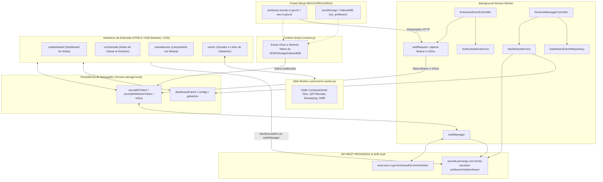
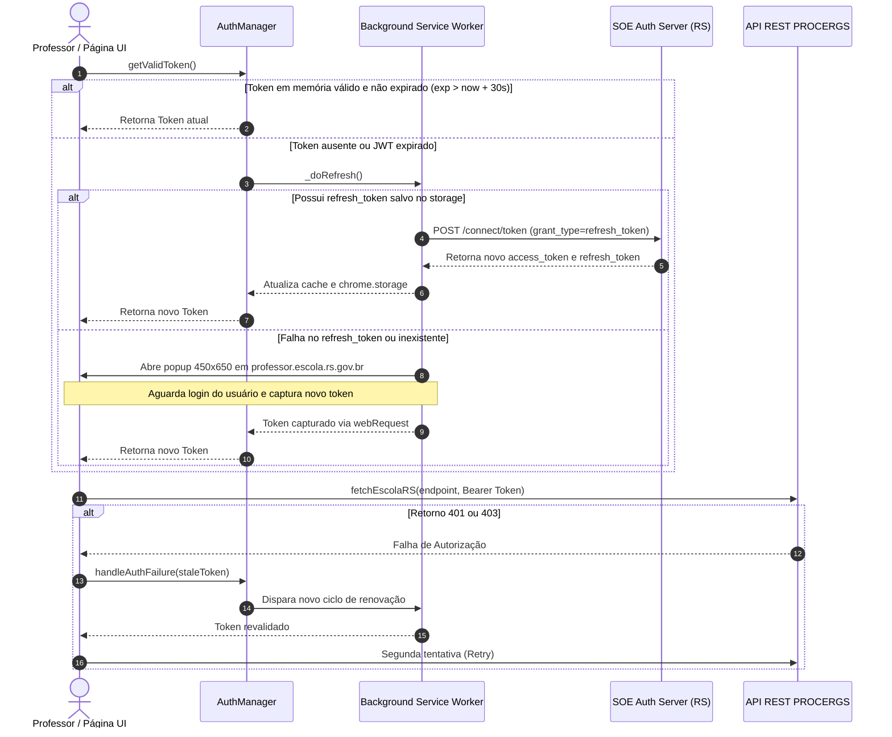
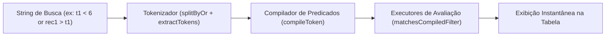

# Documentação Técnica e Conceitual — Extensão EscolaRS

> **Versão da Extensão:** 0.5.3  
> **Plataforma:** Google Chrome (Manifest V3)  
> **Público-Alvo:** Professores da rede pública estadual do Rio Grande do Sul (SEDUC-RS / PROCERGS)  
> **Repositório:** [https://github.com/EduardoLBorges/escolaRS-extensao](https://github.com/EduardoLBorges/escolaRS-extensao)

---

## 1. Visão Geral e Motivação

O **EscolaRS** é o sistema oficial de gestão escolar do Estado do Rio Grande do Sul, desenvolvido pela **PROCERGS** (Companhia de Processamento de Dados do Estado do Rio Grande do Sul) para a **SEDUC-RS** (Secretaria da Educação).

Embora o portal web oficial (`professor.escola.rs.gov.br`) permita o lançamento de notas, faltas e avaliações, ele impõe diversos desafios à rotina docente:
1. **Ausência de visão holística:** O professor precisa abrir disciplina por disciplina e turma por turma, sem uma visão panorâmica do rendimento dos estudantes.
2. **Cálculos manuais:** A conferência de médias trimestrais/semestrais e cálculo de notas mínimas para aprovação no fechamento do ano exigem esforço repetitivo.
3. **Exportação limitada:** Dificuldade para extrair relatórios estruturados para análise pedagógica em planilhas eletrônicas.
4. **Lentidão em tarefas operacionais:** Registro diário de chamadas, controle de horários, correção de avaliações objetivas e lançamento de notas instrumento por instrumento tornam-se morosos quando feitos aluno por aluno.

### Objetivo do Projeto
A **Extensão EscolaRS** opera como uma camada de aprimoramento e produtividade (Power-Tool) integrada ao navegador Google Chrome. Ela consome diretamente a API REST interna da PROCERGS, oferecendo:
- Um **Dashboard Analítico** com médias ponderadas, alertas pedagógicos e gráficos de desempenho;
- Uma **Linguagem de Consulta (DSL de Filtros)** para encontrar alunos sob quaisquer critérios pedagógicos;
- Um sistema completo de **Diário de Classe Eletrônico** com calendário, grade de horários, sábados letivos, alunos infrequentes e planos de aula;
- **Lançamento de Avaliações em Massa**, tanto por planilha Excel (.xlsx com IDs automáticos) quanto por DataGrid nativo;
- Um módulo de **Leitura Óptica de Gabaritos (OMR)** capaz de gerar folhas de resposta e corrigir provas fotografadas pelo celular em segundos com processamento de imagem em Web Worker.

---

## 2. Arquitetura do Sistema

A extensão segue a especificação **Chrome Extension Manifest V3**, dividida em contextos especializados que se comunicam através de `chrome.storage.local` e `chrome.runtime.sendMessage`.



### Componentes Principais

| Componente | Arquivo Principal | Responsabilidade |
| :--- | :--- | :--- |
| **Manifest V3** | `manifest.json` | Metadados, permissões (`storage`, `webRequest`, `notifications`), endpoints autorizados e recursos acessíveis. |
| **Service Worker** | `background.js`, `background/` | Inicializa os módulos de background; controladores conectam eventos do Chrome e mensagens, o serviço valida a sessão e o repositório persiste o cache do dashboard. |
| **Content Script** | `content.js` | Executa no contexto do portal EscolaRS para ler silenciosamente tokens OIDC e o `nrDoc` do banco IndexedDB `ise_professor`. |
| **Auth Manager** | `auth/authManager.js` | Singleton responsável por fornecer tokens válidos, verificar expiração de JWT e orquestrar renovação silenciosa ou interativa. |
| **API Client** | `api/escolaRS.js` | Cliente HTTP centralizado para a API Procergs com controle de concorrência, retries e timeouts via `AbortController`. |
| **Serviços** | `services/*.js` | Lógica de negócio do dashboard, exportação para Excel e gestão de avaliações, separada da interface. |
| **Filtro Parser** | `utils/filtroParser.js` | Motor léxico e sintático da DSL de busca combinada (notas, recuperações, projeções, regex, etc.). |
| **Motor OMR** | `ui/omr/omr-worker.js` | Web Worker dedicado para detecção de marcadores fiduciais, correção de perspectiva e leitura de bolhas. |

---

## 3. Fluxo de Autenticação e Segurança (Auth Pipeline)

A extensão funciona de forma **completamente transparente** para o professor: não é necessário digitar login ou senha dentro da extensão.

### 3.1. Fontes de Captura de Credenciais

1. **Interceptação de Headers (`chrome.webRequest`):**  
   O service worker monitora requisições feitas pelo navegador para domínios `*.procergs.com.br` e `professor.escola.rs.gov.br`.  
   - Ao detectar o header `Authorization: Bearer <JWT>`, extrai o token e atualiza o storage.
   - Ao detectar chamadas à rota `listarEscolasDoProfessorEChamadas/<nrDoc>`, captura o número de documento (`nrDoc` / CPF) do professor.

2. **Inspeção de Storage do Portal (`content.js`):**  
   Quando o professor navega pelo portal, o content script varre:
   - `localStorage` e `sessionStorage`: Procura chaves do cliente OIDC (`refresh_token`, `access_token`, `id_token` e perfil do usuário).
   - `indexedDB` (`ise_professor` → object store `usuario`): Recupera o registro persistido do usuário autenticado para obter seu `nrDoc`.

### 3.2. Ciclo de Vida do Token (`AuthManager`)



- **Margem de Segurança:** Tokens JWT são considerados expirados 30 segundos antes do timestamp `exp` real, prevenindo requisições rejeitadas no trânsito.
- **Singleton de Refresh:** Se múltiplas requisições assíncronas detectarem expiração simultaneamente, todas aguardam a mesma `_refreshPromise`, evitando rajadas de requisições à SOE.

---

## 4. Integração com a API do EscolaRS

As chamadas são centralizadas em [api/escolaRS.js](api/escolaRS.js). A base da API é `https://secweb.procergs.com.br/ise-escolars-professor/rest/professor`. As rotas pedagógicas usam autenticação Bearer e JSON (`Content-Type: application/json`).

### Endpoints

Todos os caminhos são relativos à base acima.

| Método | Caminho | Parâmetros | Uso |
| :---: | :--- | :--- | :--- |
| `GET` | `/listarEscolasDoProfessorEChamadas/{nrDoc}` | Documento do professor | Carrega escolas, turmas, disciplinas e chamadas. |
| `GET` | `/listarAulasDaTurmaComResultado/{turmaId}/{discId}/{idRecHumano}/false` | Turma, disciplina e recurso humano | Carrega alunos, aulas, períodos e resultados. |
| `GET` | `/buscarFotoDoAluno/{matricula}/{idTurma}` | Matrícula e turma | Carrega dados e foto do estudante. |
| `GET` | `/listarAvaliacoesTurma/{turmaId}/{discId}/{profId}` | Turma, disciplina e professor/recurso humano | Lista períodos e instrumentos de avaliação. |
| `GET` | `/gerarXls/{turmaId}/{discId}/{idRecHumano}/{periodoId}` | Turma, disciplina, recurso humano e período | Obtém a planilha de avaliações. |
| `GET` | `/v2/calcularAproveitamentos/professor/{idRecHumano}/turma/{turmaId}/disciplina/{discId}/periodo/{periodoId}/area/false` | Professor, turma, disciplina e período | Calcula aproveitamentos. O cliente consome `calculosAproveitamentos`, incluindo soma, média e IDs de aluno. |
| `POST` | `/chamada` | Objeto JSON | Cria ou atualiza frequência e conteúdo da aula. |
| `POST` | `/registrarResultadoInstrumentoLista` | Array JSON | Grava resultados de instrumentos, em lotes de até 20 itens. |
| `POST` | `/gravarResultadoPeriodoEmLista` | Array JSON | Grava resultados de período. |

### Estruturas GET observadas

As estruturas abaixo foram observadas nos exemplos de `amostras/` e nos campos consumidos pelo cliente.

- `/listarEscolasDoProfessorEChamadas`: objeto do professor com `nome`, `idRecHumano`, `escolas` e `avaliacoesProximas`. Escolas contêm turmas, disciplinas e chamadas.
- `/listarAulasDaTurmaComResultado`: objeto com `alunos`, `aulas`, `conceitos`, `periodos`, `periodoAtual` e `mascaraNota`. Alunos incluem `matricula`, `idTurma`, `situacao` e `listaResultados`; aulas incluem data, IDs, quantidade de períodos e conteúdo; períodos incluem ID, descrição e datas.
- `/listarAvaliacoesTurma`: array de períodos com `id`, `descricao` e `instrumentos`. Instrumentos incluem ID, nome, período, data de aplicação e metadados de cópias.
- `/buscarFotoDoAluno`: objeto do aluno com dados cadastrais, situação e `fotoBase64`.

`/gerarXls` e `/v2/calcularAproveitamentos/...` não têm amostras próprias. Para esses endpoints, os campos citados descrevem somente o consumo observado no código.

### Payloads POST

#### `/chamada`

Objeto com `idTurma`, `idDisciplina`, `idRecHumano`, `idCalenEstab`, `idCurso`, `idSerie`, `data` (`YYYY-MM-DD`), `qtPeriodos`, `registroConteudo`, `alunoFaltas`, `dataVersao`, `alunoAusenteFisicamente`, `ctrDthInc` e `ctrDthAtu`. Em atualização, inclui `idPeriodoAulaData`. Cada item de `alunoFaltas` contém `matricula` e `ausenciaFisica`; pode incluir `faltas` (array de períodos) e `faltasJustificadas` (objeto com período como chave e boolean como valor). `ctrDthInc` e `ctrDthAtu` aparecem no formato `DD/MM/YYYY HH:mm`. O cliente pode enviar `idCalenEstab: 0` quando não dispõe do identificador e envia `alunoAusenteFisicamente` como array vazio.

#### `/registrarResultadoInstrumentoLista`

Array de itens enviado em lotes de até 20. O fluxo de planilha monta cada item com `idInstrumento`, `idAluno`, `dsAproveitamento` (número) e `dataRealizacao` (data). A captura de requisição contém também `idResultadoInstrumento`, identificador de um resultado existente. O endpoint de consulta `/listarResultadosInstrumento` retorna 404; o fluxo atual não consulta resultados anteriores antes do envio.

#### `/gravarResultadoPeriodoEmLista`

Array de itens com `idAluno`, `idTurma`, `idDisciplina`, `idProfessor`, `idPeriodo`, `idArea`, `aproveitamento` (string ou `null`), `tpExpRes` e `area` (boolean). Para períodos de recuperação (ER), o dashboard também exige `idAproveitAval` e `idResultadoPeriodo`; quando disponíveis, esses campos são enviados para os demais períodos.

### Respostas POST observadas

- `/chamada`: objeto do registro gravado com `nrAulasDadas` e `respostaTransacao`. A amostra apresenta `respostaTransacao.falhou: false` e `codStatusHttp: 0`. `alunoFaltas` na resposta lista os alunos com faltas.
- `/registrarResultadoInstrumentoLista`: objeto com `falhou`, `mensagem` e `codStatusHttp`. A amostra indica sucesso com `falhou: false`.
- `/gravarResultadoPeriodoEmLista`: array de objetos com `falhou`, `mensagem`, `obj` e `codStatusHttp`. `obj` representa o resultado retornado pelo servidor e pode diferir do payload enviado.

As amostras disponíveis representam respostas de sucesso. A integração deve verificar o status HTTP e, quando presente, o campo `falhou`. O cliente da extensão lança erro em respostas HTTP não exitosas e inclui o corpo de erro na mensagem.

### Autenticação e comportamento HTTP

O Service Worker pode renovar a sessão em `POST https://www.soe.rs.gov.br/soeauth/connect/token`. O corpo usa `application/x-www-form-urlencoded` com `grant_type=refresh_token`, `refresh_token` e `client_id`. A resposta esperada contém `access_token` e `token_type`, podendo incluir um novo `refresh_token`.

`fetchEscolaRS` usa `GET` por padrão, serializa corpos JSON, aplica timeout de 30 segundos e realiza até duas tentativas. Em `401` ou `403`, delega a renovação ao `AuthManager` e repete a chamada com o token atualizado. Timeout e respostas HTTP não exitosas geram erro; o corpo de erro é incluído na mensagem.

---

## 5. Regras de Negócio e Cálculo Pedagógico

O módulo [utils/notas.js](file:///home/eduardo/repo/escolaRS-extensao/utils/notas.js) implementa com rigor as normas da SEDUC-RS para os diferentes regimes de ensino:

### 5.1. Sistema Trimestral (Ensino Fundamental e Médio Regular)
- Três trimestres com **pesos 3, 3 e 4**:
  $$\text{Média Final} = \frac{T_1 \times 3 + T_2 \times 3 + T_3 \times 4}{10}$$
- A aprovação direta exige **Média Final $\ge 6,0$**.

### 5.2. Sistema Semestral (EJA — Educação de Jovens e Adultos)
- Dois semestres com média aritmética simples:
  $$\text{Média Final} = \frac{S_1 + S_2}{2}$$

### 5.3. Estudos de Recuperação (ER)
- Se um aluno realiza o Exame de Recuperação correspondente ao período (ex: $ER_1$, $ER_2$ ou $ER_3$), o sistema compara a nota regular com a nota do exame:
  $$\text{Nota Efetiva do Período} = \max(\text{Nota Regular}, \text{Nota ER})$$
- Na interface, notas provenientes de recuperação que superaram a nota regular são sinalizadas com um asterisco visual (ex: `6,5*`).

### 5.4. Projeção de Nota Mínima para Aprovação
No período de fechamento (3º Trimestre ou 2º Semestre), a extensão calcula automaticamente a nota mínima que o aluno precisa atingir para fechar o ano com média 6,0:

- **No 3º Trimestre:**
  $$T_3 \ge \frac{60 - 3 \times (T_1 + T_2)}{4}$$
- **No 2º Semestre (EJA):**
  $$S_2 \ge 12 - S_1$$

O sistema classifica o aluno em quatro estados de projeção:
1. **Garantido (`status = 'garantido'`):** O aluno já acumula pontos suficientes para aprovação mesmo tirando 0 no período final.
2. **Normal (`status = 'normal'`):** Nota necessária calculada entre $0,1$ e $10,0$.
3. **Exame (`status = 'exame'`):** A nota necessária ultrapassaria $10,0$, indicando necessidade de realização de exame final/recuperação.
4. **Pendente (`status = 'pendente'`):** Notas de períodos anteriores ainda não foram lançadas.

### 5.5. Tratamento de Alunos Inativos
Alunos com situação diferente de ativa (transferidos, evadidos, cancelados) são identificados visualmente com estilo atenuado (cinza) e o motivo entre parênteses (ex: `(Transferido)`). **São excluídos dos cálculos de médias e indicadores de aprovação da turma**, impedindo distorções nos dados estatísticos.

---

## 6. Motor de Busca e DSL de Filtros (`filtroParser.js`)

A extensão possui um analisador léxico e compilador de predicados embutido ([utils/filtroParser.js](file:///home/eduardo/repo/escolaRS-extensao/utils/filtroParser.js)), permitindo que o professor faça buscas avançadas no campo de busca de alunos:



### Exemplos de Consultas Suportadas:

| Categoria | Sintaxe | Significado Pedagógico |
| :--- | :--- | :--- |
| **Notas por Período** | `t1 < 6` ou `t2 >= 8` | Alunos com nota abaixo de 6 no 1º Trimestre ou $\ge 8$ no 2º. |
| **Recuperações** | `rec1 > 6` ou `er2 < 6` | Filtra pelo resultado do Exame de Recuperação do período. |
| **Comparação Relativa** | `rec1 > t1` | Alunos que melhoraram a nota através da recuperação. |
| **Intervalos** | `t1: 4..6` ou `4 <= t1 <= 6` | Alunos com nota do 1º Trimestre entre 4,0 e 6,0. |
| **Média Geral** | `media < 6` ou `med >= 7` | Alunos com média final abaixo de 6 ou acima de 7. |
| **Situação e Status** | `aprov`, `recup`, `reprov` | Filtra pelo status de resultado final do aluno. |
| **Metas de Fechamento** | `precisa:garantido` ou `precisa <= 4` | Alunos já garantidos ou que precisam de no máximo 4,0 no 3º Trim. |
| **Pendências** | `semnota`, `t1:vazio`, `sem:rec1` | Alunos com notas pendentes ou sem nota no 1º Trimestre. |
| **Alertas de Inconsistência** | `alerta:er` | Identifica notas de ER lançadas sem nota regular correspondente. |
| **Operadores Lógicos** | `t1 < 6 or t2 < 6` | Disjunção com operador `or` ou `ou`. |
| **Negação** | `!aprov` ou `not t1 < 6` | Alunos que não atendem à condição. |
| **Expressões Regulares** | `/^maria/i` | Busca por nome usando expressões regulares completas. |

---

## 7. Módulos da Interface do Usuário

A extensão disponibiliza quatro grandes módulos integrados em uma navegação lateral suspensa (*Drawer Menu*):

### 7.1. Dashboard de Notas (`ui/dashboard/`)
- **Organização Hierárquica:** Agrupamento por Escola $\rightarrow$ Turma $\rightarrow$ Disciplina.
- **Estatísticas em Tempo Real:** Total de alunos ativos, turmas, média geral, percentual de aprovados e gráficos comparativos gerados com Chart.js.
- **Edição Direta de Resultados de Período:** Modo "Editar" onde o professor clica diretamente sobre a nota no período, altera o valor pelo tooltip e grava todas as mudanças pendentes em lote via `gravarResultadoPeriodoEmLista`.
- **Pré-visualização Oficial:** Consulta à API de cálculo de aproveitamentos da Procergs para conferir a consolidação antes do envio oficial.
- **Exportação XLSX:** Gera arquivo Excel completo contendo uma aba por turma com formatação condicional brasileira.
- **Backup e Restauração:** Exporta e importa arquivos `.json` com configurações de grade, horários e preferências locais.

### 7.2. Diário de Classe e Registro de Chamadas (`ui/chamada/`)
- **Calendário Dinâmico:** Visualização mensal e seleção de semana completa com contagem de aulas.
- **Lançamento de Frequência:** Registro rápido de faltas e presenças sincronizado com `POST /chamada`.
- **Quadro de Horários da Semana:** Permite configurar a grade horária semanal do professor com suporte a períodos de vigência (permitindo alterações de grade ao longo do ano).
- **Dias Letivos Customizados:** Suporte à inclusão de sábados letivos (com indicação do dia da semana de referência para montagem dos horários) e remoção de feriados/recessos.
- **Alunos Infrequentes:** Cadastro de alunos reincidentes em faltas; o sistema pré-marca falta automaticamente para eles nos novos registros de chamada da turma.
- **Planos de Aula:** Gestão pedagógica de planos de aula por disciplina para agilizar o preenchimento dos conteúdos ministrados.

### 7.3. Gerenciamento de Avaliações em Massa (`ui/avaliacoes/`)
- **DataGrid Nativo em Abas:** Permite lançar e editar notas diretamente por instrumento avaliativo (trabalhos, provas, seminários) com botão para preencher vazios com zero e salvar em lote.
- **Fluxo com Planilhas Excel:**
  1. *Exportação:* A extensão baixa o modelo oficial da Procergs, limpa os alunos inativos, injeta marcadores como `[INST:id]` no cabeçalho e adiciona a matrícula na primeira coluna.
  2. *Edição:* O professor preenche as notas offline no Excel ou Google Sheets.
  3. *Importação e Diff:* O arquivo modificado é processado no navegador, validando os IDs e submetendo apenas os dados alterados em lotes de 20 itens via `registrarResultadoInstrumentoLista`.

### 7.4. Módulo OMR — Leitor Óptico de Gabaritos (`ui/omr/`)
Permite a aplicação e correção automática de folhas de resposta com câmera de celular ou scanner:

#### A) Gerador de Folhas de Resposta (`gerador.js`)
- Gera a grade em elemento `<canvas>` com opções de 5 a 30 questões, alternativas `A-E`, `A-D`, `A-B`, `V/F` ou `C/E`, em 1 ou 2 colunas.
- Desenha os **marcadores fiduciais nos 4 cantos** no padrão **QR Code Finder Pattern** (quadrados concêntricos com proporção de varredura `1:1:3:1:1`).
- Permite download em alta resolução (300 DPI) ou cópia direta da imagem para a área de transferência para colar no final das provas no Word ou Google Docs.

#### B) Web Worker de Processamento de Imagem (`omr-worker.js`)
Executa o pipeline de visão computacional em uma thread separada para não travar a interface do navegador:
1. **Conversão para Grayscale:** Transformação ponderada dos canais RGB.
2. **Binarização Adaptativa (Otsu):** Determinação automática do melhor limiar de preto/branco pela maximização da variância inter-classes.
3. **Detecção dos Fiduciais:** Varredura horizontal à procura de sequências com proporção `1:1:3:1:1` seguida de verificação cruzada vertical.
4. **Clustering & Enquadramento:** Agrupamento de candidatos e cálculo dos 4 melhores cantos que formam o quadrilátero de respostas.
5. **Correção de Perspectiva (Dewarping):** Mapeamento inverso via interpolação bilinear das coordenadas normalizadas $(u, v)$ das bolhas.
6. **Leitura de Densidade das Bolhas:** Medição da densidade de pixels pretos em cada bolha em comparação com o fundo local para detectar marcações, em branco ou marcações duplas/ambíguas.

#### C) Fluxo de Correção em 4 Passos (`leitor.js`)
1. **Gabarito:** Seleção da turma/disciplina/instrumento e cadastro das respostas com suporte a **múltiplas formas de prova** (Forma A, Forma B, etc.).
2. **Upload:** Envio em massa de fotos (JPG, PNG, HEIC) ou arquivo compactado `.zip`.
3. **Revisão:** Interface com overlay visual sobre a folha, alternância entre foto completa e cartão corrigido, suporte a **calibração manual dos 4 cantos**, identificação automática do aluno da turma e edição manual de bolhas com dúvida.
4. **Lançamento:** Envio direto de todas as notas calculadas para a API do EscolaRS.

---

## 8. Estrutura de Diretórios do Projeto

```
escolaRS-extensao/
├── manifest.json              # Manifesto V3 da extensão Chrome
├── background.js              # Service Worker (eventos de rede, webRequest, cache)
├── content.js                 # Content script injetado no portal para extração de tokens
├── LICENSE                    # Licença do projeto (MIT)
├── README.md                  # Apresentação do projeto e guia rápido
├── DOCUMENTACAO.md            # Este documento técnico e conceitual
│
├── api/
│   └── escolaRS.js            # Cliente HTTP centralizado para a API PROCERGS
│
├── auth/
│   └── authManager.js         # Gerenciador central de tokens, expiração JWT e refresh
│
├── services/
│   ├── dashboardService.js    # Orquestração de busca e batch de turmas do dashboard
│   ├── avaliacoesService.js   # Gestão de exportação/importação de avaliações em XLS
│   └── exportService.js       # Geração de planilhas consolidadas XLSX do dashboard
│
├── utils/
│   ├── aluno.js               # Funções de filtragem e tratamento de situação de alunos
│   ├── dom.js                 # Utilitário para criação dinâmica de elementos HTML (createEl)
│   ├── filtroParser.js        # Analisador léxico e compilador de queries de busca
│   ├── notas.js               # Regras pedagógicas, pesos trimestrais e cálculo de médias
│   └── string.js              # Helpers de sanitização de strings e chaves
│
├── libs/
│   ├── chart.umd.min.js       # Gráficos estatísticos no dashboard (Chart.js)
│   ├── jszip.min.js           # Descompactação de arquivos ZIP no módulo OMR
│   ├── xlsx.full.min.js       # Manipulação avançada de planilhas Excel (SheetJS)
│   └── xlsx.mini.min.js       # Versão compacta da biblioteca SheetJS
│
├── ui/
│   ├── libs/
│   │   └── lucide.min.js      # Biblioteca de ícones (Lucide Icons)
│   ├── dashboard/
│   │   ├── dashboard.html     # Página do Dashboard de Notas
│   │   ├── dashboard.css      # Estilização do Dashboard
│   │   └── dashboard.js       # Lógica de interface, filtros e renderização do Dashboard
│   ├── chamada/
│   │   ├── chamada.html       # Página do Diário de Classe e Horários
│   │   ├── chamada.css        # Estilos do calendário e formulários de chamada
│   │   └── chamada.js         # Lógica de horários, sábados letivos e frequência
│   ├── avaliacoes/
│   │   ├── avaliacoes.html    # Página de Lançamento Direto e Importação em Massa
│   │   ├── avaliacoes.css     # Estilos da tabela de avaliações
│   │   └── avaliacoes.js      # Gerenciamento de abas e envio em lote
│   └── omr/
│       ├── omr.html           # Interface do leitor e gerador de gabaritos
│       ├── omr.css            # Estilos dos componentes OMR
│       ├── omr.js             # Inicialização e comunicação com modal
│       ├── omr-worker.js      # Web Worker de visão computacional
│       ├── gerador/
│       │   └── gerador.js     # Renderização de folhas de resposta no Canvas
│       └── leitor/
│           └── leitor.js      # Orquestrador dos 4 passos de correção de provas
│
└── images/
    ├── dashboard_anonimizado.png
    └── icons/                 # Ícones da extensão (16px, 48px, 128px)
```

---

## 9. Como Instalar e Desenvolver

### Requisitos
- Navegador Google Chrome, Brave, Edge ou qualquer navegador baseado em Chromium.
- Conta ativa de professor no sistema EscolaRS.

### Instalação em Modo Desenvolvedor
1. Clone o repositório em uma pasta local:
   ```bash
   git clone https://github.com/EduardoLBorges/escolaRS-extensao.git
   ```
2. Abra o Chrome e acesse `chrome://extensions/`.
3. No canto superior direito, ative a opção **Modo do desenvolvedor**.
4. Clique no botão **Carregar sem compactação** (ou *Load unpacked*).
5. Selecione a pasta raiz `escolaRS-extensao`.
6. Acesse o portal `https://professor.escola.rs.gov.br/` e faça login normalmente.
7. Clique no ícone da extensão no navegador para abrir o Dashboard.

---

## 10. Considerações de Privacidade e Segurança de Dados

- **Processamento 100% Local:** A extensão **não possui servidor externo próprio nem telemetria**. Todas as credenciais, dados de alunos, fotos e notas permanecem estritamente no armazenamento local do navegador (`chrome.storage.local`) e trafegam exclusivamente entre o navegador do usuário e os servidores oficiais do Governo do Estado do RS (`*.procergs.com.br` e `*.rs.gov.br`).
- **Anonimização em Demonstrações:** Qualquer documentação ou imagem pública do projeto utiliza dados fictícios ou anonimizados em conformidade com as diretrizes da LGPD (Lei Geral de Proteção de Dados).
- **Sem Interceptação de Senhas:** A extensão não armazena nem manipula senhas; utiliza estritamente os tokens de sessão já emitidos pelo servidor de identidade do Estado (SOE).
